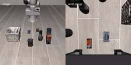
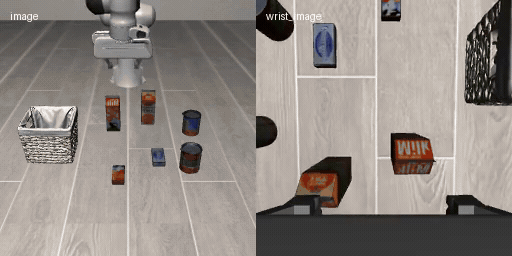
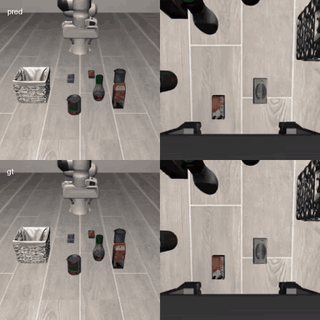
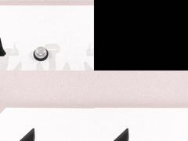
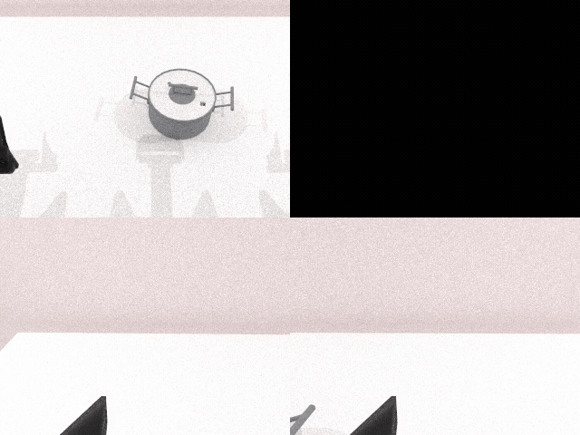
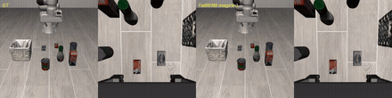

### FastWAM

This package runs [FastWAM](https://github.com/yuantianyuan01/FastWAM), a Wan2.2-TI2V-5B world-action model (T5 text encoder, Wan VAE, and a joint video/action DiT) that can plan actions with the video head skipped for speed, or imagine future frames alongside the action plan. It chains on top of a simulator base for closed-loop and interactive runs, or runs standalone on the plain base for the non-sim demos.

### Build

Set `HF_TOKEN` on the host before running for faster Hugging Face downloads.

```sh
ryzers build fastwam --name fastwam                       # just model layer: non-sim demos (videogen)
ryzers run --name fastwam                                 # test.py: ROCm torch + GPU + deps check
```

For building the image with simulation support, chain the appropriate simulation package to the build.
```
ryzers build libero   fastwam --name fastwam-libero     # chain the model on the LIBERO base
ryzers build robotwin fastwam --name fastwam-robotwin   # chain the model on the RoboTwin base
```

### Weights

Each FastWAM checkpoint is ~12 GB. Fetch the one you need (`libero`, `robotwin`, or `all`, the default) with any of the FastWAM images; they share `workspace/fastwam/models`. The Wan2.2 base (~12 GB) is downloaded from ModelScope on the first model run. Outputs are written to `workspace/fastwam/outputs`.

```sh
ryzers run --name fastwam-libero   "/ryzers/scripts/download_checkpoints.sh libero"
ryzers run --name fastwam-robotwin "/ryzers/scripts/download_checkpoints.sh robotwin"
```

### Interactive and closed-loop LIBERO

Drive the robot live in a browser, or run a batch rollout for a success rate. The interactive server streams the MuJoCo view over HTTP and prints its `http://localhost:PORT` URL.

```sh
ryzers run --name fastwam-libero /ryzers/demos/demo_interactive_libero.sh      # live browser control
ryzers run --name fastwam-libero /ryzers/demos/demo_closedloop_libero.sh       # batch rollouts + success rate
```

Closed-loop libero task, rendered headless via EGL.

<p align="center">
  
  <br>
  
  <br><em>Closed-loop LIBERO-object rollouts.</em>
</p>

With `VISUALIZE_FUTURE=true` the slow path also renders the imagined future stacked over the real rollout (imagined top, ground truth bottom).

<p align="center">
  
  <br><em>Slow path: imagined future (top) vs the real rollout (bottom).</em>
</p>

### Interactive and closed-loop RoboTwin 2.0

RoboTwin 2.0 runs under the SAPIEN Vulkan renderer. Its assets are fetched on the first run.

```sh
ryzers run --name fastwam-robotwin /ryzers/demos/demo_interactive_robotwin.sh  # live browser control
TASKS="click_bell lift_pot" NUM_EPISODES=10 \
  ryzers run --name fastwam-robotwin /ryzers/demos/demo_closedloop_robotwin.sh # batch rollouts + success rate
```

<p align="center">
  
  <br>
  
  <br><em>Closed-loop RoboTwin rollouts: click bell (top), lift pot (bottom).</em>
</p>

### Video imagination

The joint path imagines the future video and actions together (ground truth left, imagined right). It replays episodes from the preprocessed dataset (LIBERO ~5 GB; `DATASET=robotwin` works the same way with the ~80 GB RoboTwin dataset).

```sh
ryzers run --name fastwam "/ryzers/scripts/download_checkpoints.sh libero"
ryzers run --name fastwam "/ryzers/scripts/download_datasets.sh libero"
DATASET=libero ryzers run --name fastwam /ryzers/demos/demo_videogen.sh
```

<p align="center">
  
  <br><em>LIBERO: ground truth (left) vs imagined future (right).</em>
</p>


### References

- Upstream: https://github.com/yuantianyuan01/FastWAM
- Model: https://huggingface.co/yuanty/fastwam
- Datasets: https://huggingface.co/datasets/yuanty/LIBERO-fastwam, https://huggingface.co/datasets/yuanty/robotwin2.0-fastwam

Copyright (C) 2026 Advanced Micro Devices, Inc. All rights reserved.
SPDX-License-Identifier: MIT
